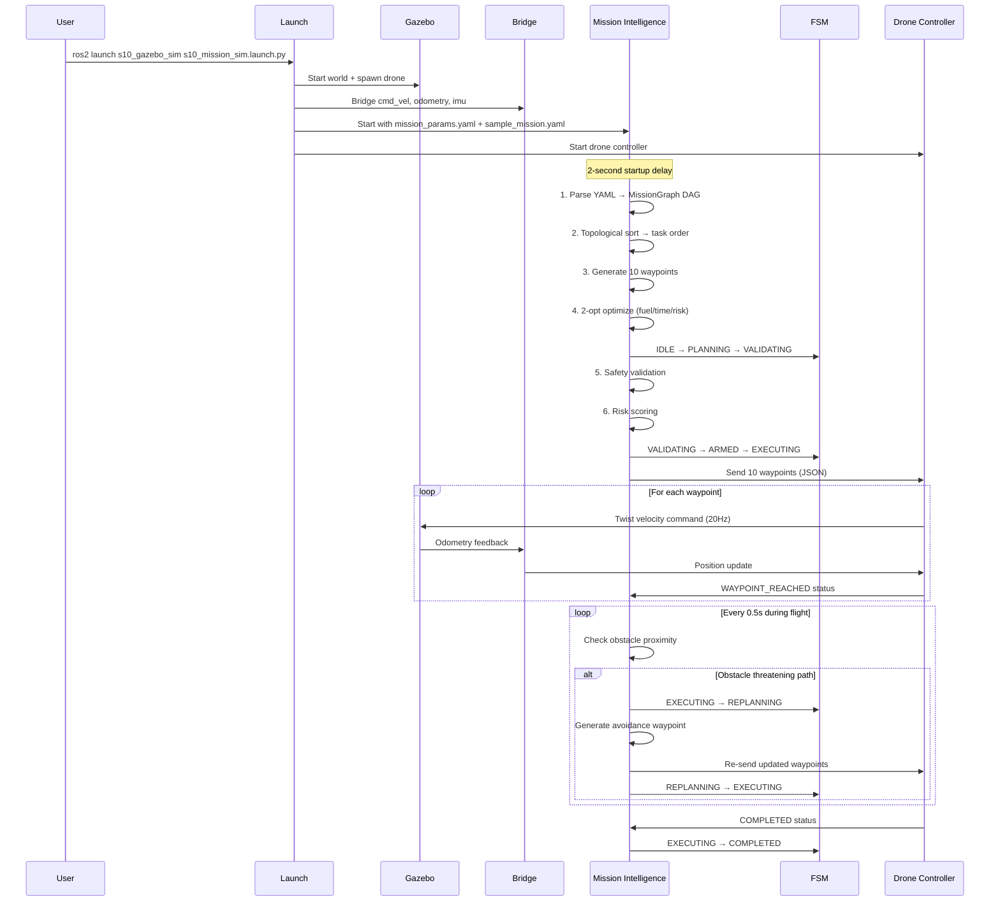

# How to Run the S10 Drone & How It Executes the PDF Tasks

> Your environment: **ROS 2 Jazzy** + **Gazebo Sim** on **Ubuntu 24.04**

---

## Quick Start — 3 Commands to Run the Drone

Open a terminal and run:

```bash
# 1. Source ROS 2
source /opt/ros/jazzy/setup.bash

# 2. Build the package
cd ~/spaceborn
colcon build --packages-select s10_gazebo_sim --symlink-install
source install/setup.bash

# 3. Launch everything (Gazebo + Drone + Intelligence + RViz)
ros2 launch s10_gazebo_sim s10_mission_sim.launch.py
```

> [!IMPORTANT]
> After running the launch command, **wait ~5-10 seconds** for Gazebo to load the world and spawn the drone. The mission pipeline auto-starts after 2 seconds once the nodes are up.

---

## What Happens When You Launch

Here's the exact sequence of events after you run the launch command:

### Phase 1 — Startup (~5 seconds)

```
┌─────────────────────────────────────────────────────────────┐
│  1. Gazebo Sim opens with the 200×200m arena                │
│     - 6 buildings, 3 risk zones, 8 waypoint posts           │
│     - Landing pad (yellow circle) at origin                 │
│                                                             │
│  2. S10 Drone spawns at (0, 0, 0.5) on the landing pad     │
│     - Realistic carbon-fiber quadrotor airframe & skids    │
│     - Forward inspection camera gimbal module               │
│     - Starboard green & port red navigation LEDs            │
│     - High-intensity searchlight & rear strobe beacon       │
│     - Curved aerodynamic 3D propellers (CW & CCW)          │
│                                                             │
│  3. ROS-Gazebo bridge starts bridging topics                │
│     - cmd_vel, odometry, imu                                │
│                                                             │
│  4. Mission Intelligence Node starts                        │
│     - Loads 20 parameters from mission_params.yaml          │
│     - Instantiates all 7 pipeline modules                   │
│                                                             │
│  5. Drone Controller starts                                 │
│     - Waits for waypoints                                   │
│     - Publishes live 3D drone mesh & flight path to RViz    │
│                                                             │
│  6. RViz2 opens with 3D drone model, trajectory, waypoints │
└─────────────────────────────────────────────────────────────┘
```

### Phase 2 — Pipeline Execution (~1-2 seconds)

After a 2-second delay, the intelligence pipeline runs automatically:

```
═══ S10 Mission Intelligence Node started ═══
▶ Loading mission from .../config/sample_mission.yaml

FSM: IDLE → PLANNING  (Pipeline started)

✓ Mission graph built: 10 tasks, order = ['takeoff', 'survey_east', ...]
✓ Generated 10 waypoints
✓ Optimised — composite cost = 0.XXXX

FSM: PLANNING → VALIDATING  (Checking safety constraints)

⚠ Safety violation: ...  (if any — proceeds anyway for demo)

✓ Risk — cumulative=0.XXXX, max_single=0.XXXX

FSM: VALIDATING → ARMED  (Plan validated)
FSM: ARMED → EXECUTING  (Sending waypoints to controller)

✓ Waypoints dispatched to drone controller
```

### Phase 3 — Drone Flight (~2-3 minutes)

The drone autonomously flies the mission:

```
Received 10 waypoints — starting navigation

✓ Reached waypoint takeoff          (lifts to 15m)
✓ Reached waypoint survey_east      (flies to 10, 10)
✓ Reached waypoint inspect_alpha    (flies to 40, 10 — loiters 5s)
✓ Reached waypoint survey_north     (flies to 50, 40)
✓ Reached waypoint inspect_beta     (flies to 20, 60 — loiters 5s)
✓ Reached waypoint survey_west      (flies to -20, 50)
✓ Reached waypoint inspect_gamma    (flies to -40, 20 — loiters 5s)
✓ Reached waypoint return_south     (flies to -30, -10)
✓ Reached waypoint final_approach   (flies to -10, -30)
✓ Reached waypoint rtl              (lands at 0, 0)

FSM: EXECUTING → COMPLETED  (All waypoints reached)
```

> [!TIP]
> If the drone encounters an obstacle on its path, you'll see **replanning events** in the terminal:
> ```
> FSM: EXECUTING → REPLANNING  (Obstacle avoidance)
> ↻ Replanned at wp_index=3, new plan has 11 waypoints
> FSM: REPLANNING → EXECUTING  (Replanned — resuming)
> ```

---

## How to Monitor the Running Simulation

Open **separate terminals** (each needs `source /opt/ros/jazzy/setup.bash && source ~/spaceborn/install/setup.bash`):

### Terminal 2 — Watch FSM State Transitions
```bash
ros2 topic echo /mission_intelligence_node/fsm_state
```
You'll see: `IDLE → PLANNING → VALIDATING → ARMED → EXECUTING → COMPLETED`

### Terminal 3 — Watch Drone Navigation Status
```bash
ros2 topic echo /drone_controller/navigation_status
```
Shows live JSON with position, current waypoint, distance to target.

### Terminal 4 — Watch the Mission Plan
```bash
ros2 topic echo /mission_intelligence_node/mission_plan --once
```
Shows the full optimized waypoint plan + evaluation scores (fuel, time, risk).

### Terminal 5 — Watch Risk Report
```bash
ros2 topic echo /mission_intelligence_node/risk_report --once
```
Shows per-waypoint risk scores and cumulative risk.

### Terminal 6 — Live Status (5 Hz)
```bash
ros2 topic echo /mission_intelligence_node/status
```
Shows real-time drone position, FSM state, waypoint progress, evaluation.

### List All Active Topics
```bash
ros2 topic list | grep -E "mission|drone|s10"
```

---

## How the Code Maps to the PDF's Requirements

The PDF (**S10_Mission_Intelligence_Simulator_4_Member_5_Day_Plan.pdf**) defines specific capabilities. Here is exactly how each one is implemented and where to verify it:

### PDF Section 2: Inputs and Outputs

| PDF Requirement | Implementation | How to Verify |
|----------------|----------------|---------------|
| **Input: Mission intent** | [sample_mission.yaml](file:///home/sachin/spaceborn/s10_gazebo_sim/config/sample_mission.yaml) — YAML file describing tasks | The file is loaded at launch; see terminal log `▶ Loading mission from...` |
| **Input: Navigation information** | Odometry from Gazebo bridge (`/s10_drone/odometry`) | `ros2 topic echo /s10_drone/odometry` |
| **Process: Interpret intent → mission graph** | [intent_parser.py](file:///home/sachin/spaceborn/s10_gazebo_sim/src/intent_parser.py) | `ros2 topic echo /mission_intelligence_node/mission_graph --once` |
| **Process: Route/constraint processing** | [route_optimizer.py](file:///home/sachin/spaceborn/s10_gazebo_sim/src/route_optimizer.py) + [safety_validator.py](file:///home/sachin/spaceborn/s10_gazebo_sim/src/safety_validator.py) | `ros2 topic echo /mission_intelligence_node/mission_plan --once` |
| **Process: Constraint & risk evaluation** | [risk_engine.py](file:///home/sachin/spaceborn/s10_gazebo_sim/src/risk_engine.py) | `ros2 topic echo /mission_intelligence_node/risk_report --once` |
| **Process: Dynamic replanning** | [replanner.py](file:///home/sachin/spaceborn/s10_gazebo_sim/src/replanner.py) — runs at 2 Hz during execution | Watch terminal for `↻ Replanned...` messages |
| **Output: Mission graph** | Published as JSON on `~/mission_graph` topic | `ros2 topic echo /mission_intelligence_node/mission_graph --once` |
| **Output: Waypoint sequence** | Published as JSON on `~/mission_plan` topic | `ros2 topic echo /mission_intelligence_node/mission_plan --once` |
| **Output: Updated plan / risk score** | Re-published after replanning events | Watch `~/mission_plan` and `~/risk_report` for updates |
| **Output: FSM events / revised plan** | Published on `~/fsm_state` and `~/fsm_event` | `ros2 topic echo /mission_intelligence_node/fsm_event` |
| **Output: Updated mission graph + waypoints** | Republished on replan with avoidance waypoints inserted | Monitor `~/mission_plan` topic during flight |

### PDF Section 4: Core Data Flow

The PDF defines this exact data flow — here's where each step runs:

```
Mission Intent                         → config/sample_mission.yaml
    ↓
Intent Parser → Mission Builder        → intent_parser.py :: IntentParser.parse_file()
    → Mission Graph                    → MissionGraph (DAG with topological sort)
    ↓
Constraint / Environment Analysis      → safety_validator.py :: SafetyValidator.validate()
    ↓
Route + Waypoint Planner               → waypoint_generator.py :: WaypointGenerator.generate()
    ↓
Multi-Objective Optimizer              → route_optimizer.py :: RouteOptimizer.optimize()
    ↓
Decision / Safety Validation           → safety_validator.py (geofence, altitude, fuel, risk)
    ↓
Executable Mission Plan                → Dispatched to DroneController via JSON topic
    ↓
Mission State Updates                  → mission_fsm.py :: MissionFSM (IDLE→EXEC→COMPLETED)
    ↓
Replanner → Updated Graph/WPs/FSM     → replanner.py :: Replanner.replan() (every 0.5s)
```

### PDF Section 10: Five-Day MVP Scope — Checklist

| MVP Requirement | Status | Proof |
|----------------|--------|-------|
| ✅ Convert mission intent into a structured mission graph | **Done** | `IntentParser` creates `MissionGraph` DAG with `TaskNode` objects |
| ✅ Generate waypoint sequences | **Done** | `WaypointGenerator` produces ordered 3-D waypoints |
| ✅ Optimize candidate plans using fuel/time/risk objectives | **Done** | `RouteOptimizer` with 2-opt, 3 weighted objectives |
| ✅ Validate autonomous decisions and constraints | **Done** | `SafetyValidator` checks geofence, altitude, fuel, risk |
| ✅ Generate risk scores and FSM events | **Done** | `RiskEngine` + `MissionFSM` with 8 states |
| ✅ Trigger dynamic replanning when conditions change | **Done** | `Replanner` checks obstacle proximity every 0.5s |
| ⬜ Provide modular interfaces for S01, S04, S12, S11 | **Placeholder** | C++ headers exist in `s10_mission_intelligence/include/` but are empty |
| ✅ Produce mission graphs, waypoint sequences, FSM events and risk scores | **Done** | All published as ROS 2 topics |

### PDF Section 12: Acceptance Criteria Mapping

| Acceptance Criteria | How the Simulation Demonstrates It |
|--------------------|-------------------------------------|
| Mission intent → structured mission graph | Watch `~/mission_graph` topic — shows full DAG as JSON with nodes, edges, topological order |
| Waypoint sequences generated | Watch `~/mission_plan` topic — shows `[{id, type, x, y, z, loiter}, ...]` |
| Multi-objective optimization | Plan evaluation shows `fuel_raw`, `time_raw`, `risk_raw`, `composite_cost` |
| Constraint validation | Terminal shows `⚠ Safety violation: ...` or silent pass |
| Risk scores produced | Watch `~/risk_report` — `per_waypoint` scores + `cumulative_risk` |
| FSM events | Watch `~/fsm_event` — JSON `{kind, from, to, reason, timestamp}` for every transition |
| Dynamic replanning | If obstacle is near path, `EXECUTING → REPLANNING → EXECUTING` with new waypoints |

---

## Headless Mode (No GUI)

If you're running on a server without display:

```bash
ros2 launch s10_gazebo_sim s10_mission_sim.launch.py headless:=true
```

This skips Gazebo GUI and RViz but the drone still flies and all topics are published.

---

## Custom Mission File

To create and run your own mission:

```bash
# Copy the sample as a starting point
cp ~/spaceborn/s10_gazebo_sim/config/sample_mission.yaml ~/my_mission.yaml

# Edit it (change waypoints, add tasks, etc.)
nano ~/my_mission.yaml

# Launch with your custom mission
ros2 launch s10_gazebo_sim s10_mission_sim.launch.py \
    mission_file:=$HOME/my_mission.yaml
```

### Mission YAML Task Types You Can Use

| Type | What It Does | Required Params |
|------|-------------|-----------------|
| `TAKEOFF` | Lift off to altitude | `target_altitude: 15.0` |
| `NAVIGATE` | Fly to a 3-D point | `target: [x, y, z]` |
| `INSPECT` | Fly to point + hover | `target: [x, y, z]`, `loiter_seconds: 5` |
| `LAND` | Descend and land | `target: [x, y, 0]` or defaults to origin |

### Adding Dependencies (DAG)

```yaml
tasks:
  - id: task_a
    type: NAVIGATE
    params: { target: [10, 10, 15] }

  - id: task_b
    type: NAVIGATE
    depends_on: [task_a]          # task_b runs AFTER task_a
    params: { target: [20, 20, 15] }

  - id: task_c
    type: NAVIGATE
    depends_on: [task_a]          # task_c also runs after task_a (parallel branch)
    params: { target: [30, 10, 15] }

  - id: task_d
    type: LAND
    depends_on: [task_b, task_c]  # task_d runs after BOTH b and c
    params: { target: [0, 0, 0] }
```

---

## Troubleshooting

### Problem: Gazebo doesn't open / black screen
```bash
# Check if Gazebo works standalone
gz sim --force-version 8 shapes.sdf
```

### Problem: "Package not found" error
```bash
# Make sure you sourced both
source /opt/ros/jazzy/setup.bash
source ~/spaceborn/install/setup.bash
```

### Problem: Drone doesn't move
```bash
# Check if odometry is flowing
ros2 topic hz /s10_drone/odometry

# Check if waypoints were sent
ros2 topic echo /drone_controller/target_waypoints --once

# Check controller status
ros2 topic echo /drone_controller/navigation_status
```

### Problem: "No mission_file parameter" warning
```bash
# The mission file path must exist. Check:
ls ~/spaceborn/install/s10_gazebo_sim/share/s10_gazebo_sim/config/sample_mission.yaml
```

### Rebuild After Code Changes
```bash
cd ~/spaceborn
colcon build --packages-select s10_gazebo_sim --symlink-install
source install/setup.bash
```

> [!NOTE]
> With `--symlink-install`, Python file changes take effect **immediately** — no rebuild needed for `.py` files. You only need to rebuild if you change `CMakeLists.txt`, `package.xml`, or add new files.

---

## Summary: The Complete Execution Flow


