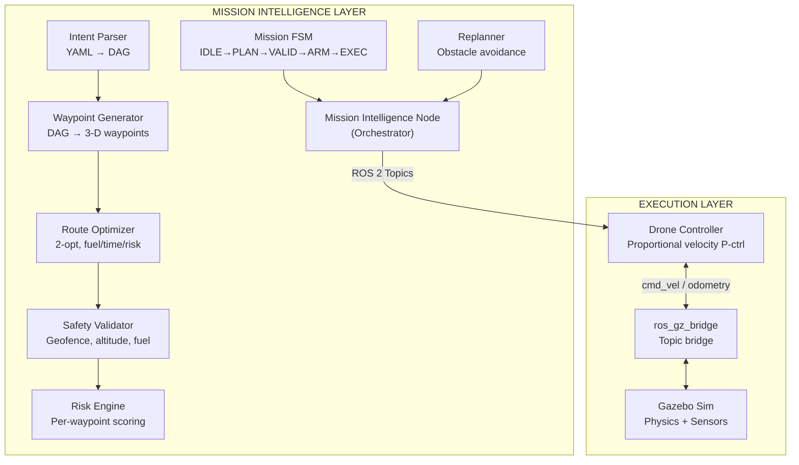
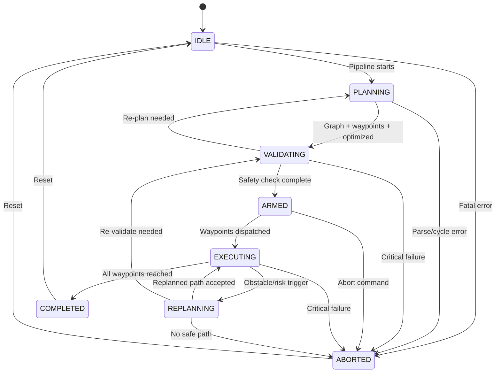

# S10 Mission Intelligence Simulator — Complete Documentation

> **Project:** Spaceborn S10 Mission Intelligence  
> **Version:** 0.1.0  
> **License:** MIT  
> **Maintainer:** Sachin (`sachin@spaceborn.dev`)

---

## Table of Contents

1. [Project Overview](#1-project-overview)
2. [Repository Structure](#2-repository-structure)
3. [System Architecture](#3-system-architecture)
4. [The 8-Stage Mission Intelligence Pipeline](#4-the-8-stage-mission-intelligence-pipeline)
   - 4.1 [Stage 1 — Intent Parsing](#41-stage-1--intent-parsing)
   - 4.2 [Stage 2 — Mission Graph Construction](#42-stage-2--mission-graph-construction)
   - 4.3 [Stage 3 — Waypoint Generation](#43-stage-3--waypoint-generation)
   - 4.4 [Stage 4 — Multi-Objective Route Optimization](#44-stage-4--multi-objective-route-optimization)
   - 4.5 [Stage 5 — Safety Validation](#45-stage-5--safety-validation)
   - 4.6 [Stage 6 — Risk Scoring](#46-stage-6--risk-scoring)
   - 4.7 [Stage 7 — FSM Execution](#47-stage-7--fsm-execution)
   - 4.8 [Stage 8 — Dynamic Replanning](#48-stage-8--dynamic-replanning)
5. [Module-by-Module Breakdown](#5-module-by-module-breakdown)
6. [Drone Controller](#6-drone-controller)
7. [ROS 2 Topics & Data Flow](#7-ros-2-topics--data-flow)
8. [Finite State Machine (FSM) Lifecycle](#8-finite-state-machine-fsm-lifecycle)
9. [Gazebo Simulation World](#9-gazebo-simulation-world)
10. [Drone Model (SDF)](#10-drone-model-sdf)
11. [Configuration Reference](#11-configuration-reference)
12. [Launch System](#12-launch-system)
13. [RViz Visualization](#13-rviz-visualization)
14. [Sample Mission Walkthrough](#14-sample-mission-walkthrough)
15. [Dependencies & Prerequisites](#15-dependencies--prerequisites)
16. [How to Build & Run](#16-how-to-build--run)
17. [Package: s10_mission_intelligence (C++ Library — Placeholder)](#17-package-s10_mission_intelligence-c-library--placeholder)
18. [Algorithms Deep Dive](#18-algorithms-deep-dive)
19. [Design Decisions & Trade-offs](#19-design-decisions--trade-offs)

---

## 1. Project Overview

The **S10 Mission Intelligence Simulator** is a ROS 2 + Gazebo Sim based autonomous drone mission planning and execution system. It demonstrates a complete end-to-end pipeline that takes a human-readable **mission intent** (YAML file describing *what* the operator wants) and autonomously:

1. Parses the intent into a Directed Acyclic Graph (DAG) of tasks
2. Generates 3-D waypoints for each task
3. Optimizes the route using multi-objective optimization (fuel, time, risk)
4. Validates the plan against safety constraints (geofence, altitude, fuel, risk)
5. Scores each waypoint and the overall plan for risk
6. Executes the mission via a Finite State Machine (FSM) with live state transitions
7. Dynamically replans in real-time when obstacles or high-risk zones threaten the current path
8. Flies the drone in Gazebo Sim using proportional velocity control

The system is designed as a **mission autonomy framework** — separating the *intelligence layer* (planning, validation, risk) from the *execution layer* (flight control, Gazebo physics).

---

## 2. Repository Structure

```
spaceborn/
├── s10_gazebo_sim/                    # ROS 2 package — simulation & intelligence nodes
│   ├── CMakeLists.txt                 # ament_cmake build configuration
│   ├── package.xml                    # ROS 2 package manifest (dependencies)
│   ├── launch/
│   │   └── s10_mission_sim.launch.py  # Main launch file (Gazebo + nodes)
│   ├── src/
│   │   ├── mission_intelligence_node.py  # Main orchestrator node (504 lines)
│   │   ├── intent_parser.py              # YAML → MissionGraph DAG
│   │   ├── waypoint_generator.py         # Graph → 3-D waypoint sequence
│   │   ├── route_optimizer.py            # Multi-objective 2-opt optimization
│   │   ├── safety_validator.py           # Constraint checking engine
│   │   ├── risk_engine.py                # Per-waypoint & cumulative risk scoring
│   │   ├── mission_fsm.py               # Finite State Machine for mission lifecycle
│   │   ├── replanner.py                  # Dynamic obstacle avoidance & replanning
│   │   └── drone_controller.py           # Proportional velocity waypoint tracker
│   ├── config/
│   │   ├── mission_params.yaml           # Node parameters (flight, optimization, safety)
│   │   └── sample_mission.yaml           # Example mission intent file
│   ├── worlds/
│   │   └── s10_mission_world.sdf         # Gazebo world (200×200m arena)
│   ├── models/
│   │   └── s10_drone/
│   │       ├── model.config              # Gazebo model metadata
│   │       └── model.sdf                 # Quadrotor SDF (physics + sensors + plugins)
│   └── rviz/
│       └── s10_mission.rviz              # RViz2 display configuration
│
├── s10_mission_intelligence/          # C++ library package (placeholder/scaffolding)
│   ├── LICENSE.md                     # MIT license
│   ├── README.md                      # (empty — to be filled)
│   ├── config/                        # (empty YAML placeholders)
│   │   ├── mission.yaml
│   │   ├── objectives.yaml
│   │   └── scenarios.yaml
│   ├── include/                       # C++ header stubs
│   │   ├── s10_constraints.h
│   │   ├── s10_fsm.h
│   │   ├── s10_graph.h
│   │   ├── s10_interface.h
│   │   ├── s10_mission.h
│   │   ├── s10_risk.h
│   │   └── s10_waypoint.h
│   └── src/                           # Module directory stubs
│       ├── adapters/
│       ├── core/
│       ├── fsm/
│       ├── intent/
│       ├── logger/
│       ├── optimization/
│       ├── output/
│       ├── planning/
│       ├── risk/
│       └── validation/
│
├── build/                             # colcon build output
├── install/                           # colcon install output
└── log/                               # colcon build logs
```

---

## 3. System Architecture

The system follows a **pipeline architecture** with clear separation of concerns:



### Key Design Principles

| Principle | Implementation |
|-----------|---------------|
| **Intent-driven** | Operator specifies *what* (YAML), system decides *how* |
| **DAG-based planning** | Tasks form a dependency graph, executed in topological order |
| **Multi-objective optimization** | Fuel, time, and risk are weighted and jointly minimized |
| **Safety-first validation** | Plans are checked against geofence, altitude, fuel, and risk limits |
| **Live replanning** | Obstacle proximity triggers automatic path re-routing at runtime |
| **State machine governance** | All lifecycle transitions are FSM-controlled and logged |
| **Visualization-ready** | RViz markers for waypoints, routes, and risk zones in real-time |

---

## 4. The 8-Stage Mission Intelligence Pipeline

The pipeline runs once when the node starts (triggered by a 2-second one-shot timer to allow full node initialization).

### 4.1 Stage 1 — Intent Parsing

**Module:** [intent_parser.py](file:///home/sachin/spaceborn/s10_gazebo_sim/src/intent_parser.py) → `IntentParser`

**Purpose:** Transform a human-authored YAML mission file into a structured `MissionGraph` DAG.

**How it works:**
1. Reads the YAML file using `yaml.safe_load()`
2. Extracts mission metadata: `id`, `name`, `description`, `priority`, `time_limit_seconds`
3. Iterates over the `tasks` list and creates a `TaskNode` for each
4. Each `TaskNode` has: `id`, `task_type` (TAKEOFF/NAVIGATE/INSPECT/LAND), `description`, `depends_on` (list of prerequisite task IDs), `params` (target coordinates, loiter time, etc.)
5. Stores all nodes in the `MissionGraph.nodes` dictionary keyed by task ID

**Data Classes:**

```python
@dataclass
class TaskNode:
    id: str                    # Unique identifier (e.g., "takeoff", "inspect_alpha")
    task_type: str             # TAKEOFF | NAVIGATE | INSPECT | LAND
    description: str           # Human-readable description
    depends_on: List[str]      # List of prerequisite task IDs
    params: Dict               # Task-specific parameters (target, altitude, loiter)
    status: str                # PENDING → ACTIVE → DONE | SKIPPED

@dataclass
class MissionGraph:
    mission_id: str
    name: str
    description: str
    priority: str              # NORMAL | HIGH | CRITICAL
    time_limit: float          # Maximum mission duration (seconds)
    nodes: Dict[str, TaskNode] # All tasks indexed by ID
    objectives: List[Dict]     # Multi-objective optimization goals
    constraints: Dict          # Safety constraints
```

**Input Example (from [sample_mission.yaml](file:///home/sachin/spaceborn/s10_gazebo_sim/config/sample_mission.yaml)):**
```yaml
mission:
  id: "S10-DEMO-001"
  name: "Perimeter Survey & Inspection"
  tasks:
    - id: takeoff
      type: TAKEOFF
      params:
        target_altitude: 15.0
    - id: survey_east
      type: NAVIGATE
      depends_on: [takeoff]
      params:
        target: [10.0, 10.0, 15.0]
```

### 4.2 Stage 2 — Mission Graph Construction

**Module:** [intent_parser.py](file:///home/sachin/spaceborn/s10_gazebo_sim/src/intent_parser.py) → `MissionGraph`

**Purpose:** Build and validate the DAG structure.

**Topological Sort (Kahn's Algorithm):**
1. Compute in-degree for each node (how many tasks it depends on)
2. Initialize a queue with all zero-in-degree nodes
3. Repeatedly dequeue a node, add to the execution order, and decrement in-degrees of its dependents
4. If the resulting order has fewer nodes than the graph, there is a cycle → reject

**Validation Checks:**
- No cycles in the dependency graph
- All `depends_on` references point to existing task IDs
- At least one `TAKEOFF` task exists
- At least one `LAND` task exists

**Output:** A validated `MissionGraph` object + topological execution order (e.g., `['takeoff', 'survey_east', 'inspect_alpha', ..., 'rtl']`)

### 4.3 Stage 3 — Waypoint Generation

**Module:** [waypoint_generator.py](file:///home/sachin/spaceborn/s10_gazebo_sim/src/waypoint_generator.py) → `WaypointGenerator`

**Purpose:** Convert the abstract task graph into a concrete sequence of 3-D waypoints the drone can fly.

**Logic per task type:**

| Task Type | X, Y | Z (Altitude) | Loiter |
|-----------|------|---------------|--------|
| `TAKEOFF` | 0, 0 (launch pad) | `target_altitude` or cruise | 0 |
| `NAVIGATE` | From `params.target[0:2]` | `target[2]` or cruise altitude | 0 |
| `INSPECT` | From `params.target[0:2]` | `target[2]` or cruise altitude | `loiter_seconds` |
| `LAND` | From `params.target[0:2]` or (0,0) | 0.0 | 0 |

**Output format:**
```python
[
  {"id": "takeoff", "type": "TAKEOFF", "x": 0.0, "y": 0.0, "z": 15.0, "loiter": 0},
  {"id": "survey_east", "type": "NAVIGATE", "x": 10.0, "y": 10.0, "z": 15.0, "loiter": 0},
  ...
]
```

**Utility Functions:**
- `total_distance(waypoints)` — Sum of Euclidean distances between consecutive waypoints
- `estimated_time(waypoints, speed)` — `distance / speed + total_loiter`

### 4.4 Stage 4 — Multi-Objective Route Optimization

**Module:** [route_optimizer.py](file:///home/sachin/spaceborn/s10_gazebo_sim/src/route_optimizer.py) → `RouteOptimizer`

**Purpose:** Minimize a weighted composite cost of fuel, time, and risk.

**Three Cost Models:**

1. **Fuel Cost:** `total_3D_distance × fuel_rate_per_metre`
2. **Time Cost:** `total_3D_distance / cruise_speed + Σ loiter_seconds`
3. **Risk Cost:** For each segment, sample the midpoint `(mx, my)` and check against risk zones. If inside a zone: `severity × (1 - d/r) × (segment_length / 50)`

**Normalization:**
- Fuel → `min(fuel / 100, 1.0)`
- Time → `min(time / 600, 1.0)`
- Risk → `min(risk, 1.0)`

**Composite Cost:**
```
composite = w_fuel × fuel_norm + w_time × time_norm + w_risk × risk_norm
```

Default weights: `fuel=0.35, time=0.40, risk=0.25`

**2-opt Local Search:**
1. Fix the first waypoint (TAKEOFF) and last waypoint (LAND)
2. For the middle waypoints, try all 2-opt swaps (reverse a sub-segment)
3. Accept any swap that reduces composite cost by > 1e-6
4. Repeat until no further improvement is found

**Output:** `(optimized_waypoints, evaluation_dict)` where `evaluation_dict` contains:
```json
{
  "fuel_raw": 28.4,
  "time_raw": 67.3,
  "risk_raw": 0.12,
  "fuel_norm": 0.284,
  "time_norm": 0.1122,
  "risk_norm": 0.12,
  "composite_cost": 0.1743
}
```

### 4.5 Stage 5 — Safety Validation

**Module:** [safety_validator.py](file:///home/sachin/spaceborn/s10_gazebo_sim/src/safety_validator.py) → `SafetyValidator`

**Purpose:** Check the optimized plan against hard safety constraints.

**Constraint Checks:**

| Constraint | Check | Threshold |
|-----------|-------|-----------|
| **Geofence** | `sqrt(x² + y²)` for each waypoint | ≤ 90 m from origin |
| **Min Altitude** | `z` for each waypoint (except LAND) | ≥ 5 m |
| **Max Altitude** | `z` for each waypoint | ≤ 50 m |
| **Cumulative Risk** | `risk_raw` from evaluation | ≤ 0.85 |
| **Fuel Capacity** | `fuel_raw` from evaluation | ≤ 100 units |

**Output:** `(passed: bool, violations: List[str])`

> [!NOTE]
> For demo purposes, violations are flagged as warnings but the mission proceeds regardless.

### 4.6 Stage 6 — Risk Scoring

**Module:** [risk_engine.py](file:///home/sachin/spaceborn/s10_gazebo_sim/src/risk_engine.py) → `RiskEngine`

**Purpose:** Compute fine-grained per-waypoint and cumulative risk scores.

**Risk Sources:**

1. **Risk Zones** `(cx, cy, radius, severity)`:
   - If waypoint is inside zone: `risk += severity × (1 - distance/radius)`
   - Linear falloff from center (max severity) to edge (zero)

2. **Obstacles** `(cx, cy, half_width)`:
   - Danger radius = `half_width × 2`
   - If waypoint is within danger radius: `risk += 0.3 × (1 - distance/danger_radius)`

**Output:**
```json
{
  "per_waypoint": [
    {"id": "takeoff", "risk": 0.0},
    {"id": "inspect_alpha", "risk": 0.32}
  ],
  "cumulative_risk": 0.0845,
  "max_single_risk": 0.32
}
```

### 4.7 Stage 7 — FSM Execution

**Module:** [mission_fsm.py](file:///home/sachin/spaceborn/s10_gazebo_sim/src/mission_fsm.py) → `MissionFSM`

**Purpose:** Govern the mission lifecycle through a state machine.

**States:** `IDLE`, `PLANNING`, `VALIDATING`, `ARMED`, `EXECUTING`, `REPLANNING`, `COMPLETED`, `ABORTED`

The pipeline transitions the FSM through states as each stage completes. Once in `EXECUTING`, waypoints are dispatched to the drone controller.

*(Full FSM details in [Section 8](#8-finite-state-machine-fsm-lifecycle))*

### 4.8 Stage 8 — Dynamic Replanning

**Module:** [replanner.py](file:///home/sachin/spaceborn/s10_gazebo_sim/src/replanner.py) → `Replanner`

**Purpose:** Monitor the drone's live position and reroute if obstacles or high-severity risk zones threaten the current path segment.

**Trigger Conditions:**
1. **Obstacle proximity:** Midpoint of (drone → next_waypoint) segment is within `trigger_distance` (default 8m) of any obstacle
2. **Risk zone penetration:** Midpoint is deep inside a high-severity (≥0.6) risk zone (within 50% of zone radius)

**Avoidance Strategy:**
1. Find the closest obstacle to the segment midpoint
2. Compute the perpendicular direction to the drone→waypoint vector
3. Generate two candidate avoidance points offset by `(half_width + 5)` metres in each perpendicular direction
4. Choose the candidate that is **farther** from the obstacle
5. Insert this avoidance waypoint before the current target in the plan

**Cooldown:** Minimum 5 seconds between replanning events to prevent oscillation.

**On Replan:**
1. FSM transitions to `REPLANNING`
2. Waypoints are updated, re-evaluated, and risk re-scored
3. Updated waypoints are re-sent to the drone controller
4. FSM transitions back to `EXECUTING`

---

## 5. Module-by-Module Breakdown

### 5.1 [mission_intelligence_node.py](file:///home/sachin/spaceborn/s10_gazebo_sim/src/mission_intelligence_node.py) — The Orchestrator

| Aspect | Detail |
|--------|--------|
| **Lines of Code** | 504 |
| **ROS Node Name** | `mission_intelligence_node` |
| **Role** | Central orchestrator — wires all pipeline modules together |
| **Parameters** | 20 declared parameters (see [Section 11](#11-configuration-reference)) |
| **Publishers** | 9 topics (see [Section 7](#7-ros-2-topics--data-flow)) |
| **Subscribers** | 2 topics (odometry, navigation status) |
| **Timers** | 4 periodic timers (markers, status, replan check, pipeline kickoff) |

**Initialization Flow:**
1. Declare and read all ROS parameters
2. Parse risk zones and obstacles from flat parameter arrays
3. Instantiate all pipeline modules (parser, waypoint gen, optimizer, validator, risk engine, FSM, replanner)
4. Create all publishers and subscribers
5. Register FSM transition callback
6. Create periodic timers
7. Schedule a one-shot 2-second timer to run the pipeline

### 5.2 [intent_parser.py](file:///home/sachin/spaceborn/s10_gazebo_sim/src/intent_parser.py) — Intent Parser

| Aspect | Detail |
|--------|--------|
| **Lines of Code** | 134 |
| **Key Classes** | `IntentParser`, `TaskNode`, `MissionGraph` |
| **Algorithm** | Kahn's topological sort for dependency ordering |
| **Validation** | Cycle detection, missing dependencies, TAKEOFF/LAND presence |

### 5.3 [waypoint_generator.py](file:///home/sachin/spaceborn/s10_gazebo_sim/src/waypoint_generator.py) — Waypoint Generator

| Aspect | Detail |
|--------|--------|
| **Lines of Code** | 105 |
| **Key Class** | `WaypointGenerator` |
| **Supports** | 2-D and 3-D target coordinates, configurable cruise altitude |
| **Utilities** | `total_distance()`, `estimated_time()` |

### 5.4 [route_optimizer.py](file:///home/sachin/spaceborn/s10_gazebo_sim/src/route_optimizer.py) — Route Optimizer

| Aspect | Detail |
|--------|--------|
| **Lines of Code** | 136 |
| **Key Class** | `RouteOptimizer` |
| **Algorithm** | 2-opt local search on interior waypoints |
| **Objectives** | Fuel (distance-based), Time (distance + loiter), Risk (zone proximity) |
| **Complexity** | O(n³) worst case for n interior waypoints |

### 5.5 [safety_validator.py](file:///home/sachin/spaceborn/s10_gazebo_sim/src/safety_validator.py) — Safety Validator

| Aspect | Detail |
|--------|--------|
| **Lines of Code** | 92 |
| **Key Class** | `SafetyValidator` |
| **Constraints** | Geofence radius, altitude bounds, risk threshold, fuel capacity |
| **Output** | Pass/Fail boolean + list of violation strings |

### 5.6 [risk_engine.py](file:///home/sachin/spaceborn/s10_gazebo_sim/src/risk_engine.py) — Risk Engine

| Aspect | Detail |
|--------|--------|
| **Lines of Code** | 66 |
| **Key Class** | `RiskEngine` |
| **Scoring** | Per-waypoint risk ∈ [0, 1], cumulative = average of per-waypoint scores |
| **Sources** | Risk zones (linear severity falloff), Obstacles (proximity penalty) |

### 5.7 [mission_fsm.py](file:///home/sachin/spaceborn/s10_gazebo_sim/src/mission_fsm.py) — Mission FSM

| Aspect | Detail |
|--------|--------|
| **Lines of Code** | 94 |
| **Key Classes** | `MissionState` (Enum), `MissionFSM` |
| **States** | 8 states with strictly defined transitions |
| **Features** | Callback system, event logging with timestamps, JSON serialization |

### 5.8 [replanner.py](file:///home/sachin/spaceborn/s10_gazebo_sim/src/replanner.py) — Dynamic Replanner

| Aspect | Detail |
|--------|--------|
| **Lines of Code** | 149 |
| **Key Class** | `Replanner` |
| **Triggers** | Obstacle proximity, high-severity risk zone penetration |
| **Strategy** | Perpendicular avoidance waypoint insertion |

### 5.9 [drone_controller.py](file:///home/sachin/spaceborn/s10_gazebo_sim/src/drone_controller.py) — Drone Controller

| Aspect | Detail |
|--------|--------|
| **Lines of Code** | 186 |
| **Key Class** | `DroneController` |
| **Control Law** | Proportional velocity control with speed clamping |
| **Loop Rate** | 20 Hz (50ms timer) |
| **Features** | Waypoint acceptance radius, loiter support, status feedback |

---

## 6. Drone Controller

The [DroneController](file:///home/sachin/spaceborn/s10_gazebo_sim/src/drone_controller.py#L28) is a separate ROS 2 node that handles the low-level flight execution.

### Control Law

```
dx, dy, dz = target - current_position
dist_3d = sqrt(dx² + dy² + dz²)

speed = min(cruise_speed, dist_3d × 0.8, max_speed)

twist.linear.x = (dx / dist_3d) × speed
twist.linear.y = (dy / dist_3d) × speed
twist.linear.z = (dz / dist_3d) × speed
```

This is a **proportional controller** where:
- Speed is proportional to distance (×0.8 gain) — slows down as it approaches
- Speed is clamped to `cruise_speed` (5 m/s) and `max_speed` (8 m/s)
- Direction is the normalized vector from current to target position

### Waypoint Acceptance

A waypoint is considered "reached" when `dist_3d < acceptance_radius` (default: 2.0m).

### Loiter Behavior

If a waypoint has `loiter > 0` seconds:
1. On first arrival, set `loiter_until = now + loiter`
2. Hover in place (zero velocity) until the loiter timer expires
3. Then mark the waypoint as reached and advance to the next

### Status Feedback

The controller publishes JSON status messages at every control loop iteration:
```json
{
  "state": "NAVIGATING|ARRIVED|LOITERING|WAYPOINT_REACHED|COMPLETED",
  "detail": "→ inspect_alpha  dist=12.4m",
  "wp_index": 3,
  "total_wps": 10,
  "position": {"x": 15.23, "y": 8.91, "z": 14.87},
  "timestamp": 1697234567.89
}
```

---

## 7. ROS 2 Topics & Data Flow

### Published by `mission_intelligence_node`

| Topic | Type | Rate | Description |
|-------|------|------|-------------|
| `~/mission_graph` | `std_msgs/String` | Once | JSON-serialized mission DAG |
| `~/mission_plan` | `std_msgs/String` | On plan/replan | JSON waypoints + evaluation |
| `~/risk_report` | `std_msgs/String` | On score/replan | JSON per-waypoint risk + cumulative |
| `~/fsm_state` | `std_msgs/String` | On transition | Current FSM state name |
| `~/fsm_event` | `std_msgs/String` | On transition | JSON event log entry |
| `~/status` | `std_msgs/String` | 5 Hz | JSON overall status (state, position, eval) |
| `~/waypoint_markers` | `MarkerArray` | 2 Hz | RViz spheres + labels + route line |
| `~/risk_zone_markers` | `MarkerArray` | 2 Hz | RViz cylinders for risk zones |
| `/drone_controller/target_waypoints` | `std_msgs/String` | On execute/replan | JSON waypoint list for controller |

### Subscribed by `mission_intelligence_node`

| Topic | Type | Source | Purpose |
|-------|------|--------|---------|
| `/s10_drone/odometry` | `nav_msgs/Odometry` | Gazebo bridge | Drone position tracking |
| `/drone_controller/navigation_status` | `std_msgs/String` | Drone controller | Waypoint reached / mission complete |

### Published by `drone_controller`

| Topic | Type | Rate | Description |
|-------|------|------|-------------|
| `/s10_drone/cmd_vel` | `geometry_msgs/Twist` | 20 Hz | Velocity commands to Gazebo |
| `~/navigation_status` | `std_msgs/String` | 20 Hz | JSON navigation state feedback |

### Subscribed by `drone_controller`

| Topic | Type | Source | Purpose |
|-------|------|--------|---------|
| `/s10_drone/odometry` | `nav_msgs/Odometry` | Gazebo bridge | Current drone position |
| `~/target_waypoints` | `std_msgs/String` | Intelligence node | Waypoint list to execute |

### ROS ↔ Gazebo Bridge Topics

| ROS Topic | Gazebo Topic | Direction | Message Type |
|-----------|-------------|-----------|--------------|
| `/s10_drone/cmd_vel` | `gz.msgs.Twist` | ROS → Gazebo | `geometry_msgs/Twist` |
| `/s10_drone/odometry` | `gz.msgs.Odometry` | Gazebo → ROS | `nav_msgs/Odometry` |
| `/s10_drone/imu` | `gz.msgs.IMU` | Gazebo → ROS | `sensor_msgs/Imu` |

---

## 8. Finite State Machine (FSM) Lifecycle

### State Diagram



### Transition Table

| From | To | Trigger |
|------|----|---------|
| `IDLE` | `PLANNING` | Pipeline starts |
| `IDLE` | `ABORTED` | Fatal error |
| `PLANNING` | `VALIDATING` | Graph built + waypoints generated + optimized |
| `PLANNING` | `ABORTED` | Parse error, cycle in graph |
| `VALIDATING` | `ARMED` | Safety validation complete |
| `VALIDATING` | `PLANNING` | Re-plan needed |
| `VALIDATING` | `ABORTED` | Critical failure |
| `ARMED` | `EXECUTING` | Waypoints dispatched to controller |
| `ARMED` | `ABORTED` | Abort command |
| `EXECUTING` | `REPLANNING` | Obstacle/risk trigger |
| `EXECUTING` | `COMPLETED` | All waypoints reached |
| `EXECUTING` | `ABORTED` | Critical failure |
| `REPLANNING` | `EXECUTING` | Replanned path accepted |
| `REPLANNING` | `VALIDATING` | Re-validate needed |
| `REPLANNING` | `ABORTED` | Cannot find safe path |
| `COMPLETED` | `IDLE` | Reset |
| `ABORTED` | `IDLE` | Reset |

### Event Logging

Every transition (including rejected ones) is logged as a JSON event:
```json
{
  "kind": "TRANSITION",
  "from": "PLANNING",
  "to": "VALIDATING",
  "reason": "Checking safety constraints",
  "timestamp": 1697234567.89
}
```

---

## 9. Gazebo Simulation World

**File:** [s10_mission_world.sdf](file:///home/sachin/spaceborn/s10_gazebo_sim/worlds/s10_mission_world.sdf)

### Arena Specifications

| Property | Value |
|----------|-------|
| **Size** | 200 × 200 metres |
| **Physics engine** | DART |
| **Timestep** | 1 ms (0.001 s) |
| **Real-time factor** | 1.0 |

### World Contents

#### Ground Plane
- Olive-green ground surface, 200×200m

#### Landing Pad
- Yellow cylinder at the origin (0, 0)
- Radius: 1.5m, height: 0.02m
- Launch and return point

#### 6 Obstacle Buildings

| Building | Position (x, y, z) | Size (w × d × h) | Color |
|----------|-------------------|-------------------|-------|
| building_1 | (20, 15, 5) | 6×6×10 m | Grey |
| building_2 | (-25, 30, 7.5) | 8×4×15 m | Brown |
| building_3 | (35, -20, 4) | 5×10×8 m | Blue-grey |
| building_4 | (-15, -35, 6) | 7×7×12 m | Tan |
| building_5 | (50, 50, 3.5) | 4×12×7 m | Dark slate |
| building_6 | (-50, -10, 5) | 10×5×10 m | Neutral |

#### 3 Risk Zones (Translucent Ground Circles)

| Zone | Center (x, y) | Radius | Severity | Color |
|------|---------------|--------|----------|-------|
| risk_zone_1 | (30, 30) | 15 m | 0.8 | Red (high) |
| risk_zone_2 | (-30, -25) | 12 m | 0.6 | Red (medium) |
| risk_zone_3 | (-40, 40) | 10 m | 0.4 | Orange (low) |

#### 8 Waypoint Posts (Green Poles with Sphere Tops)

| Post | Position (x, y) | Corresponding Mission Task |
|------|-----------------|---------------------------|
| wp1 | (10, 10) | survey_east |
| wp2 | (40, 10) | inspect_alpha |
| wp3 | (50, 40) | survey_north |
| wp4 | (20, 60) | inspect_beta |
| wp5 | (-20, 50) | survey_west |
| wp6 | (-40, 20) | inspect_gamma |
| wp7 | (-30, -10) | return_south |
| wp8 | (-10, -30) | final_approach |

### Gazebo Plugins

| Plugin | Purpose |
|--------|---------|
| `gz-sim-physics-system` | DART physics simulation |
| `gz-sim-scene-broadcaster-system` | Visual scene updates |
| `gz-sim-user-commands-system` | Runtime entity commands |
| `gz-sim-sensors-system` | Sensor data (ogre2 renderer) |
| `gz-sim-imu-system` | IMU sensor processing |
| `gz-sim-contact-system` | Collision detection |

---

## 10. Drone Model (SDF)

**File:** [model.sdf](file:///home/sachin/spaceborn/s10_gazebo_sim/models/s10_drone/model.sdf)

### Physical Properties

| Property | Value |
|----------|-------|
| **Mass** | 1.5 kg (body) + 0.02 kg × 4 (rotors) = 1.58 kg total |
| **Fuselage** | 0.35 × 0.35 × 0.12 m box |
| **Rotor radius** | 0.12 m (disc visual) |
| **Arm span** | ~0.65 m (diagonal) |
| **Color** | Dark grey body, green LED indicator |

### Links and Joints

| Link | Purpose | Position |
|------|---------|----------|
| `base_link` | Main body with fuselage, 4 arms, LED, IMU sensor | Origin |
| `rotor_0` | Front-Right rotor (CW) | (0.23, -0.23, 0.08) |
| `rotor_1` | Front-Left rotor (CCW) | (0.23, 0.23, 0.08) |
| `rotor_2` | Rear-Left rotor (CW) | (-0.23, 0.23, 0.08) |
| `rotor_3` | Rear-Right rotor (CCW) | (-0.23, -0.23, 0.08) |

All rotors are connected to `base_link` via continuous revolute joints.

### Sensors

**IMU Sensor:**
- Update rate: 250 Hz
- Topic: `s10_drone/imu`
- Noise: Gaussian (gyro σ=0.0002, accel σ=0.017)

### Drone Plugins

| Plugin | Purpose |
|--------|---------|
| `MulticopterMotorModel` (×4) | Rotor physics (thrust, drag, moment constants) |
| `MulticopterVelocityControl` | Velocity command interface (`cmd_vel` topic) |
| `OdometryPublisher` | 50 Hz odometry output |
| `PosePublisher` | Ground-truth pose (50 Hz) |

### Velocity Controller Gains

```
Velocity:   P = (6, 6, 10)    I = (1, 1, 2)
Attitude:   P = (4, 4, 2)     I = (0, 0, 0)
Angular:    P = (1, 1, 1)     I = (0, 0, 0)
```

---

## 11. Configuration Reference

### [mission_params.yaml](file:///home/sachin/spaceborn/s10_gazebo_sim/config/mission_params.yaml) — Full Parameter List

```yaml
mission_intelligence_node:
  ros__parameters:

    # ── File ────────────────────────────────────────────
    mission_file: ""              # Path to mission YAML (set by launch arg)

    # ── Flight ──────────────────────────────────────────
    cruise_altitude: 15.0         # metres AGL — default cruise height
    cruise_speed: 5.0             # m/s — nominal forward speed
    waypoint_acceptance_radius: 2.0  # metres — "arrived" threshold
    max_speed: 8.0                # m/s — hard speed limit

    # ── Optimization Weights ────────────────────────────
    weight_fuel: 0.35             # Importance of fuel efficiency
    weight_time: 0.40             # Importance of time efficiency
    weight_risk: 0.25             # Importance of risk avoidance
    # Note: weights should sum to 1.0

    # ── Risk Zones ──────────────────────────────────────
    # Flat array: [cx, cy, radius, severity, cx, cy, ...]
    risk_zones: [
      30.0,  30.0, 15.0, 0.8,    # Zone 1: high severity
      -30.0, -25.0, 12.0, 0.6,   # Zone 2: medium severity
      -40.0,  40.0, 10.0, 0.4    # Zone 3: low severity
    ]

    # ── Obstacles ───────────────────────────────────────
    # Flat array: [cx, cy, half_width, cx, cy, ...]
    obstacles: [
      20.0,  15.0,  5.0,         # Building 1
      -25.0, 30.0,  6.0,         # Building 2
      35.0, -20.0,  6.0,         # Building 3
      -15.0,-35.0,  5.5,         # Building 4
      50.0,  50.0,  7.0,         # Building 5
      -50.0,-10.0,  7.0          # Building 6
    ]

    # ── Safety Constraints ──────────────────────────────
    min_altitude: 5.0             # metres — floor
    max_altitude: 50.0            # metres — ceiling
    geofence_radius: 90.0         # metres from origin — boundary
    max_risk_score: 0.85          # reject if cumulative risk exceeds
    fuel_capacity: 100.0          # abstract units
    fuel_rate_per_metre: 0.12     # units consumed per metre flown

    # ── Replanning ──────────────────────────────────────
    replan_trigger_distance: 8.0  # metres — obstacle proximity trigger
    replan_cooldown: 5.0          # seconds between replanning events

    # ── Publishing Rates ────────────────────────────────
    marker_publish_rate: 2.0      # Hz — RViz marker refresh
    status_publish_rate: 5.0      # Hz — status topic refresh
```

### [sample_mission.yaml](file:///home/sachin/spaceborn/s10_gazebo_sim/config/sample_mission.yaml) — Mission Intent Format

```yaml
mission:
  id: "S10-DEMO-001"
  name: "Perimeter Survey & Inspection"
  description: >
    Conduct a perimeter survey of the operational area, inspect three
    points of interest, and return to the landing pad.
  priority: HIGH
  time_limit_seconds: 600            # 10 minutes max

  tasks:
    - id: <unique_string>
      type: TAKEOFF | NAVIGATE | INSPECT | LAND
      description: "Human-readable description"
      depends_on: [<list of prerequisite task IDs>]
      params:
        target: [x, y, z]            # 3-D coordinates (metres)
        target_altitude: <float>      # TAKEOFF only
        loiter_seconds: <int>         # INSPECT only

  objectives:
    - name: fuel | time | risk
      weight: <float>
      direction: MINIMIZE

  constraints:
    geofence_radius: <float>
    min_altitude: <float>
    max_altitude: <float>
    max_cumulative_risk: <float>
```

---

## 12. Launch System

**File:** [s10_mission_sim.launch.py](file:///home/sachin/spaceborn/s10_gazebo_sim/launch/s10_mission_sim.launch.py)

### What Gets Launched

| Order | Component | Details |
|-------|-----------|---------|
| 1 | `GZ_SIM_RESOURCE_PATH` | Environment variable set to models directory |
| 2 | **Gazebo Sim** | `ros_gz_sim/gz_sim.launch.py` with the S10 world |
| 3 | **Spawn Drone** | `ros_gz_sim/create` — spawns `s10_drone` at (0, 0, 0.5) |
| 4 | **ROS-GZ Bridge** | Bridges `cmd_vel`, `odometry`, and `imu` topics |
| 5 | **Mission Intelligence Node** | The main orchestrator with parameters |
| 6 | **Drone Controller** | Velocity waypoint tracker |
| 7 | **RViz2** | (unless `headless:=true`) with S10 display config |

### Launch Arguments

| Argument | Default | Description |
|----------|---------|-------------|
| `headless` | `false` | Run without Gazebo GUI and RViz |
| `mission_file` | `config/sample_mission.yaml` | Path to the mission intent YAML |

### Usage Examples

```bash
# Full simulation with GUI
ros2 launch s10_gazebo_sim s10_mission_sim.launch.py

# Headless mode (CI / testing)
ros2 launch s10_gazebo_sim s10_mission_sim.launch.py headless:=true

# Custom mission file
ros2 launch s10_gazebo_sim s10_mission_sim.launch.py \
    mission_file:=/path/to/custom_mission.yaml
```

---

## 13. RViz Visualization

**File:** [s10_mission.rviz](file:///home/sachin/spaceborn/s10_gazebo_sim/rviz/s10_mission.rviz)

### Display Configuration

| Display | Topic | Description |
|---------|-------|-------------|
| **Grid** | — | 20×20 grid, 10m cell size, XY plane, dark grey |
| **Waypoint Markers** | `~/waypoint_markers` | Colored spheres + text labels + route line |
| **Risk Zone Markers** | `~/risk_zone_markers` | Red translucent cylinders |

### Waypoint Marker Colors

| Waypoint Type | Color (R, G, B) | Description |
|---------------|-----------------|-------------|
| TAKEOFF | (0.0, 0.8, 1.0) | Cyan |
| LAND | (1.0, 0.8, 0.0) | Gold |
| INSPECT | (1.0, 0.3, 0.9) | Magenta-pink |
| NAVIGATE | (0.2, 1.0, 0.3) | Green |
| Current target | 2.5× size, full opacity | Highlighted |

### Camera

- Orbit view, distance 150m
- Focal point: (0, 0, 10)
- Pitch: 0.7 rad (~40°), Yaw: 0.8 rad (~46°)
- Background: dark (30, 30, 40)

---

## 14. Sample Mission Walkthrough

The included [sample_mission.yaml](file:///home/sachin/spaceborn/s10_gazebo_sim/config/sample_mission.yaml) defines a **"Perimeter Survey & Inspection"** mission:

### Mission Flow

```
   takeoff (0,0) → z=15m
       ↓
   survey_east (10, 10, 15)
       ↓
   inspect_alpha (40, 10, 15) — loiter 5s
       ↓
   survey_north (50, 40, 15)
       ↓
   inspect_beta (20, 60, 15) — loiter 5s
       ↓
   survey_west (-20, 50, 15)
       ↓
   inspect_gamma (-40, 20, 15) — loiter 5s
       ↓
   return_south (-30, -10, 15)
       ↓
   final_approach (-10, -30, 15)
       ↓
   rtl (0, 0, 0) — LAND
```

### Dependency Chain (DAG)

All tasks are linearly dependent (each depends on the previous), forming a simple chain:

```
takeoff → survey_east → inspect_alpha → survey_north → inspect_beta
→ survey_west → inspect_gamma → return_south → final_approach → rtl
```

### Expected Behavior

1. **Pipeline** runs in ~1 second:
   - Parses 10 tasks into a DAG
   - Generates 10 waypoints
   - 2-opt may swap middle waypoints if composite cost improves
   - Safety validation checks all constraints
   - Risk scoring evaluates proximity to the 3 risk zones

2. **Execution** (~2-3 minutes at 5 m/s cruise):
   - Drone lifts off to 15m
   - Flies the optimized route
   - Loiters 5s at each INSPECT point
   - Dynamic replanning activates if obstacles threaten any segment
   - Lands at origin

---

## 15. Dependencies & Prerequisites

### System Requirements

| Requirement | Minimum Version |
|-------------|----------------|
| **Ubuntu** | 22.04 (Jammy) |
| **ROS 2** | Humble Hawksbill |
| **Gazebo Sim** | Fortress or Garden |
| **Python** | 3.10+ |

### ROS 2 Package Dependencies

| Package | Purpose |
|---------|---------|
| `rclpy` | ROS 2 Python client library |
| `std_msgs` | String messages |
| `geometry_msgs` | Twist, Point |
| `nav_msgs` | Odometry |
| `sensor_msgs` | Imu |
| `visualization_msgs` | Marker, MarkerArray |
| `tf2_ros` | Transform utilities |
| `ros_gz_sim` | Gazebo Sim integration |
| `ros_gz_bridge` | ROS ↔ Gazebo topic bridge |
| `ros_gz_image` | Image transport bridge |
| `launch` | Launch system |
| `launch_ros` | ROS 2 launch actions |

### Python Dependencies

| Library | Purpose |
|---------|---------|
| `yaml` (PyYAML) | Mission file parsing |
| `json` | Data serialization |
| `math` | Distance calculations |
| `dataclasses` | TaskNode, MissionGraph |
| `enum` | MissionState FSM states |

---

## 16. How to Build & Run

### Build

```bash
cd ~/spaceborn
colcon build --symlink-install
source install/setup.bash
```

### Run the Full Simulation

```bash
ros2 launch s10_gazebo_sim s10_mission_sim.launch.py
```

### Monitor Topics

```bash
# Watch FSM state transitions
ros2 topic echo /mission_intelligence_node/fsm_state

# Watch mission plan
ros2 topic echo /mission_intelligence_node/mission_plan

# Watch risk report
ros2 topic echo /mission_intelligence_node/risk_report

# Watch drone navigation status
ros2 topic echo /drone_controller/navigation_status

# Watch overall status (5 Hz)
ros2 topic echo /mission_intelligence_node/status
```

### List All Active Topics

```bash
ros2 topic list | grep -E "(mission|drone|s10)"
```

---

## 17. Package: s10_mission_intelligence (C++ Library — Placeholder)

The [s10_mission_intelligence/](file:///home/sachin/spaceborn/s10_mission_intelligence) directory is a **scaffolded C++ library** intended to be the production-grade implementation of the mission intelligence pipeline. Currently, all header files and source directories are **empty placeholders**.

### Planned C++ Header Map

| Header | Purpose | Python Equivalent |
|--------|---------|-------------------|
| `s10_mission.h` | Mission data structures | `intent_parser.py` (TaskNode, MissionGraph) |
| `s10_graph.h` | DAG operations, topo sort | `intent_parser.py` (MissionGraph methods) |
| `s10_interface.h` | Public API / interfaces | `mission_intelligence_node.py` |
| `s10_fsm.h` | State machine | `mission_fsm.py` |
| `s10_risk.h` | Risk scoring | `risk_engine.py` |
| `s10_waypoint.h` | Waypoint generation | `waypoint_generator.py` |
| `s10_constraints.h` | Safety constraints | `safety_validator.py` |

### Planned Source Modules

| Directory | Purpose |
|-----------|---------|
| `src/adapters/` | ROS 2 adapters, serialization |
| `src/core/` | Core pipeline logic |
| `src/fsm/` | FSM implementation |
| `src/intent/` | Intent parser |
| `src/logger/` | Structured logging |
| `src/optimization/` | Route optimizer |
| `src/output/` | Output formatters |
| `src/planning/` | Mission planner |
| `src/risk/` | Risk engine |
| `src/validation/` | Safety validator |

---

## 18. Algorithms Deep Dive

### 18.1 Kahn's Topological Sort

Used in [MissionGraph.topological_order()](file:///home/sachin/spaceborn/s10_gazebo_sim/src/intent_parser.py#L47-L66) to determine execution order.

```
Input:  Graph with nodes and directed edges (dependencies)
Output: Linear ordering respecting all dependencies

1. Compute in-degree for each node
2. Queue ← all nodes with in-degree = 0
3. While Queue is not empty:
   a. Dequeue node N
   b. Append N to result order
   c. For each child C of N:
      - Decrement in-degree(C)
      - If in-degree(C) == 0, enqueue C
4. If |result| < |nodes|: graph has a cycle → error
```

**Time Complexity:** O(V + E) where V = tasks, E = dependencies

### 18.2 2-opt Local Search

Used in [RouteOptimizer.optimize()](file:///home/sachin/spaceborn/s10_gazebo_sim/src/route_optimizer.py#L65-L96) to improve waypoint ordering.

```
Input:  Waypoint sequence [TAKEOFF, w1, w2, ..., wn, LAND]
Output: Improved sequence minimizing composite cost

1. Fix TAKEOFF (head) and LAND (tail)
2. middle ← [w1, w2, ..., wn]
3. best ← middle, best_cost ← evaluate(head + middle + tail)
4. Repeat:
   improved ← false
   For i = 0 to |middle|-2:
     For j = i+1 to |middle|-1:
       candidate ← reverse(middle[i..j])
       cost ← evaluate(head + candidate + tail)
       If cost < best_cost - ε:
         best ← candidate
         best_cost ← cost
         improved ← true
   Until not improved
5. Return head + best + tail
```

**Time Complexity:** O(n³) per improvement pass, O(n⁴) worst case with multiple passes

### 18.3 Risk Zone Scoring

```
For each waypoint at position (x, y):
  risk = 0.0

  For each risk_zone (cx, cy, radius, severity):
    distance = sqrt((x-cx)² + (y-cy)²)
    if distance < radius:
      risk += severity × (1 - distance/radius)   # Linear falloff

  For each obstacle (cx, cy, half_width):
    distance = sqrt((x-cx)² + (y-cy)²)
    danger_radius = half_width × 2
    if distance < danger_radius:
      risk += 0.3 × (1 - distance/danger_radius)  # Fixed 0.3 penalty

  return min(risk, 1.0)   # Clamp to [0, 1]
```

### 18.4 Perpendicular Avoidance

Used in [Replanner.generate_avoidance_waypoint()](file:///home/sachin/spaceborn/s10_gazebo_sim/src/replanner.py#L66-L117):

```
Given: drone position (dx, dy), next waypoint (wx, wy), obstacle (cx, cy, hw)

1. midpoint = ((dx+wx)/2, (dy+wy)/2)
2. segment_vector = (wx-dx, wy-dy), length = |segment_vector|
3. perpendicular = (-seg_y/len, seg_x/len)
4. offset = hw + 5.0  (half_width + clearance)

5. option_a = midpoint + perpendicular × offset
   option_b = midpoint - perpendicular × offset

6. Choose the option FARTHER from the obstacle center
7. Insert chosen point as an avoidance waypoint before the next waypoint
```

---

## 19. Design Decisions & Trade-offs

| Decision | Rationale |
|----------|-----------|
| **Python for MVP** | Faster iteration, easier ROS 2 integration; C++ planned for production |
| **Flat parameter arrays for nested data** | ROS 2 doesn't natively support nested YAML lists in parameters; stride-based parsing works around this |
| **2-opt instead of genetic/ant-colony** | Sufficient for 10-waypoint plans; keeps complexity low for demo |
| **Proportional (P) controller only** | Simple, stable for Gazebo sim; PID would add complexity without demo benefit |
| **Single avoidance waypoint** | Keeps replanning fast; multiple waypoints could cause oscillation |
| **5-second replan cooldown** | Prevents rapid replanning oscillation near obstacle boundaries |
| **Safety violations as warnings, not blocks** | Demo-friendly; production system should enforce hard blocks |
| **JSON over ROS 2 topics** | Flexible, human-readable; production should use custom message types |
| **One-shot pipeline + periodic replan** | Pipeline runs once at start; replanner runs every 0.5s during execution |

---

> **Document generated from full source analysis of the `spaceborn` workspace.**  
> All code references are from the `s10_gazebo_sim` package (v0.1.0).
